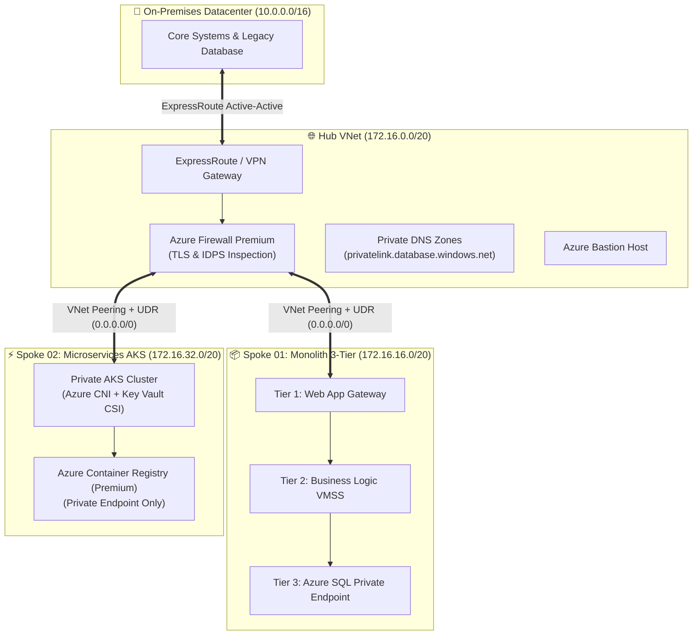

<div align="center">

  <!-- ========================================================================================================= -->
  <!-- DYNAMIC ANIMATED HEADER HERO BANNER -->
  <!-- ========================================================================================================= -->
  

  <!-- DYNAMIC TYPING SVG ANIMATION -->
  <a href="https://git.io/typing-svg">
    
  </a>

  <br/><br/>

  <!-- QUICK ACTION BADGES & CONNECT LINKS -->
  <p align="center">
    <a href="mailto:raghvendrasingh.devops@gmail.com"></a>
    &nbsp;
    <a href="https://linkedin.com/in/raghvendra-singh-devops"></a>
    &nbsp;
    <a href="https://github.com/raghvendrasingh-devops"></a>
    &nbsp;
    <a href="#"></a>
  </p>

  <!-- QUICK METRICS ROW -->
  <p align="center">
    
    &nbsp;
    
    &nbsp;
    
    &nbsp;
    
    &nbsp;
    
  </p>

</div>

---

## ⚡ The Mission Control Manifesto

```yaml
# ===================================================================================
# THE BHAKUA ENGINEER CORE MANIFESTO
# ===================================================================================
engineer:
  name: "Raghvendra Singh"
  title: "Principal DevSecOps Architect & Autonomous AI Platform Strategist"
  alias: "The Bhakua Engineer" # In the trenches, turning operational chaos into bulletproof code
  tenets:
    - "Automate everything that moves; codify everything that breathes."
    - "Zero Trust is not an option; it is the default posture."
    - "If a deployment cannot roll back automatically in 60 seconds, it is not production-ready."
    - "FinOps is architectural discipline: high performance without wasted dollar economics."
    - "Next-generation SRE is Autonomous: LLM-driven agents that observe, triage, and heal."
```

---

<div align="center">
  <h2>📊 Real-Time Operational Telemetry & GitHub HUD</h2>

  <table align="center" border="0" cellpadding="8">
    <tr>
      <td align="center">
        
      </td>
      <td align="center">
        
      </td>
    </tr>
    <tr>
      <td align="center" colspan="2">
        
      </td>
    </tr>
  </table>
</div>

---

## 🛰️ Executive Competency & Leadership Matrix

| Functional Area | Architecture Scope & Engineering Mastery | Key Deliverables & Tech Stack |
| :--- | :--- | :--- |
| **🏛️ Cloud Architecture & CAF** | Enterprise Landing Zones, Tenant & Management Group Hierarchy, Subscription Boundaries, Guardrails | Azure CAF (Plan, Ready, Adopt, Govern, Secure, Manage), Microsoft Entra ID, Azure Policy & Initiatives, PIM, Custom RBAC |
| **🌐 Zero-Trust Networking** | Hub-and-Spoke Topology, Centralized Inspection, IPAM / CIDR Planning, Controlled Egress | Azure Firewall Premium (IDPS/TLS), ExpressRoute, S2S VPN, Private DNS Zones, Private Endpoints, UDRs |
| **⚙️ Terraform Enterprise IaC** | Remote State Security, Encryption at Rest, Reusable Modules, Linting, Drift Detection | Terraform Enterprise, TFLint, tfsec, Checkov, TruffleHog, Infracost, Terratest, Azure Blob Lease Locks |
| **🔄 Enterprise CI/CD DevSecOps** | Trunk-Based Branching, Multi-Stage Pipeline Templates, Shift-Left Security Gates, Automated Rollback | Azure DevOps Pipelines, GitHub Actions, SonarQube, Trivy, Docker, Helm, ArgoCD, Canary & Blue/Green |
| **🚚 100+ App Mass Migration** | Discovery, Wave Planning, 6R Framework, Zero-Downtime Cutover Protocols, Hypercare War Rooms | Azure Migrate, DMA (Data Migration Assistant), Log Shipping, RACI Matrices, DNS Switchover Strategies |
| **🤖 Agentic AI Platform Ops** | Autonomous SRE Incident Triagers, LLM-based IaC PR Reviewers, Self-Healing Infrastructure Agents | Python, LangChain, OpenAI API, Azure Resource Graph, KQL Automated Diagnostics, GitOps AI Bots |
| **💵 FinOps & Cost Engineering** | Unit Economics, Idle Disk & Orphaned IP Reclaim, VM Right-Sizing, Start/Stop Automation, RI/Savings Plans | Azure Advisor, Infracost, Cost Management, Scheduled Automation Runbooks, Log Ingestion Optimization |
| **🛡️ Resilience, HA & Disaster Recovery** | Storage Redundancy (LRS/ZRS/GRS), VMSS Auto-scaling, RTO < 15m / RPO < 5m Multi-Region Active/Passive | Azure Front Door, Traffic Manager, Azure Site Recovery, Backup Vaults, Availability Zones (AZ 1, 2, 3) |
| **👔 Leadership & Governance** | Vendor Management, SOW Authoring, RFP/RFI Evaluation Matrices, Stakeholder Delivery, Team Upskilling | Architecture Review Board (ARB), SOP Authoring, RACI Handovers, Technical Interviews, Mentorship |

---

## 🏛️ Comprehensive Architecture Blueprint

```
                                      [ MICROSOFT ENTRA ID TENANT ]
                                                     │
                                         [ TENANT ROOT GROUP ]
                                       (Global Deny Guardrails)
                       ┌─────────────────────────────┼─────────────────────────────┐
                       │                             │                             │
              [ PLATFORM MG ]               [ LANDING ZONES MG ]             [ SANDBOX MG ]
         ┌─────────────┼─────────────┐               ┌──────┴──────┐               │
         ▼             ▼             ▼               ▼             ▼               ▼
    [MANAGEMENT] [CONNECTIVITY]  [IDENTITY]        [CORP]       [ONLINE]      [POC & R&D]
         │             │             │               │             │        (Budget Caps &
     Log Anal.    Hub VNet      Entra Domain     Spoke 01      Spoke 02      Auto-Shutdown)
    Automation   Azure Firewall  Controllers   (Monolith 3-Tier) (AKS Cluster)
    Backup Vault ExpressRoute/VPN  Key Vaults    (Azure SQL PE)  (ACR Private)
```

---

## 🔬 In-Depth Engineering Pillars & Field Manuals

---

### 📘 Pillar 01: Enterprise Scale Landing Zones & Azure CAF

The Cloud Adoption Framework (CAF) is applied across the six strategic phases: **Plan**, **Ready**, **Adopt**, **Govern**, **Secure**, and **Manage**.

#### 1. Management Group & Tenant Hierarchy Design
* **Tenant Root Group**: Enforces baseline non-negotiable guardrails across the entire enterprise. Prevents non-compliant region deployments, enforces resource tagging schema, and denies public IP creation.
* **Platform Management Group**:
  * `Management MG`: Centralized Log Analytics Workspaces, Automation Accounts, Azure Backup Vaults, and diagnostic settings ingestion.
  * `Connectivity MG`: Central Hub Virtual Network, Azure Firewall Premium, ExpressRoute / VPN Gateways, and Centralized Private DNS Zones.
  * `Identity MG`: Active Directory Domain Controllers, Identity synchronization servers, and corporate Key Vaults.
* **Landing Zones Management Group**:
  * `Corp (Corporate)`: Internal-only workloads routed strictly via the Hub without public ingress or egress.
  * `Online`: External internet-facing applications fronted by Azure Front Door / Application Gateway with WAF policies.
* **Sandbox & Decommissioned MGs**: Isolated environments with hard spending limits, automatic resource termination timers, and automated cleanup policies.

#### 2. Subscription Boundaries & Lifecycle
* **Subscription Sizing**: Decoupled platform and application boundaries to avoid ARM rate-limiting, isolate blast radiuses, and streamline FinOps chargebacks.
* **Subscription Onboarding/Offboarding Automation**: Terraform-driven provisioning of new subscriptions with pre-configured RBAC role assignments, budget alerts, and network peering templates.

#### 3. Policy-as-Code & Governed Policy Exemptions
* **Initiatives**: Comprehensive enforcement of CIS Azure Foundations Benchmark and ISO 27001 initiatives.
* **Policy Exemption Framework**: Formal process requiring architectural justification, risk sign-off, and automated expiration dates.

---

### 🌐 Pillar 02: Zero-Trust Hub-and-Spoke Networking Topology



#### 1. IPAM & Non-Overlapping CIDR Strategy
* Non-overlapping network partitions between On-Premises (`10.0.0.0/16`), Cloud Hub (`172.16.0.0/20`), Monolithic Spoke (`172.16.16.0/20`), and Microservices Spoke (`172.16.32.0/20`).
* Subnet segmentation: `AzureFirewallSubnet` (/26), `GatewaySubnet` (/27), `AzureBastionSubnet` (/26), and dedicated application subnets.

#### 2. Centralized Inspection & Forced Egress
* **User-Defined Routes (UDRs)**: Every spoke subnet associates with a route table directing `0.0.0.0/0` outbound traffic directly to the internal IP of the Azure Firewall.
* **Azure Firewall Premium**: Operates in `AlertAndDeny` mode with Intrusion Detection and Prevention System (IDPS) and TLS Inspection enabled.

#### 3. Private Link & Private Endpoints
* Zero public IP exposure for Azure SQL, Storage Accounts, Key Vaults, and Container Registries.
* Centralized Private DNS Zones linked to all VNets for private name resolution.

---

### ⚙️ Pillar 03: Terraform Enterprise IaC Automation Engine

```
[ Developer Branch ] ──► [ Pull Request ] ──► [ TFLint & fmt ] ──► [ Checkov & TruffleHog ]
                                                                             │
[ Apply to Production ] ◄── [ Manual Gate ] ◄── [ Terraform Plan ] ◄── [ Infracost Delta ]
           │
           ▼
[ Scheduled Drift Detection Pipeline ] ──► (Drift Found) ──► [ Automated Alert / Slack ]
```

#### 1. Production State Management & Security
* Remote state files stored in geo-redundant Azure Storage (GRS) with TLS 1.3, Customer-Managed Keys (CMK), and Private Endpoints.
* Strict RBAC role enforcement (no static storage access keys permitted).
* Blob Lease locks prevent simultaneous deployment race conditions.

#### 2. Automated Quality & Security Gateways
* **Pre-commit & CI Checks**: `terraform fmt -check`, `tflint --recursive`, and `terratest`.
* **Static Application Security Testing (SAST)**: `checkov` and `tfsec` ensure full compliance with CIS benchmarks.
* **Secret Leak Detection**: `trufflehog` and `GitGuardian` scan git commits for embedded keys or credentials.
* **FinOps Pre-Apply Cost Checks**: `infracost diff` automatically posts comment breakdowns on Pull Requests showing projected monthly cost impacts.
* **Continuous Drift Detection**: Scheduled cron pipelines execute `terraform plan -detailed-exitcode` daily, posting alerts upon unauthorized manual changes.

---

### 🔄 Pillar 04: Enterprise DevSecOps CI/CD Delivery Pipeline

#### 1. Branching Governance
* **Trunk-Based Development**: Short-lived feature branches (< 24 hours).
* **Branch Protection Policies**:
  * Direct commits to `main` strictly prohibited (`No Delete`, `No Force Push`).
  * Minimum 2 senior code reviewer approvals required.
  * Mandatory Code Owners review and 100% passing status checks.

#### 2. Multi-Stage Pipeline Templates
```yaml
stages:
  - stage: Validate_and_Lint
    jobs: [Linting, SyntaxCheck, SecretScanning]
  - stage: Security_Audit
    jobs: [Checkov_SAST, Trivy_Container_Scan, Snyk_SCA]
  - stage: Plan_and_Cost
    jobs: [Terraform_Plan, Infracost_Analysis]
  - stage: Canary_Deploy
    jobs: [Deploy_Staging, Synthetic_Smoke_Tests]
  - stage: Production_Promotion
    jobs: [Manual_Approval_Gate, Zero_Downtime_Deploy, Automated_Rollback_Watchdog]
```

---

### 🚚 Pillar 05: 100+ Enterprise Application Migration Framework

#### 1. The 6R Migration Strategy
* **Rehost**: Lift & shift of legacy VMs using Azure Migrate with minimal modifications.
* **Replatform**: Moving SQL Server databases to Azure SQL Managed Instance and web apps to Azure App Services.
* **Refactor**: Re-architecting core business logic into containerized microservices hosted on Azure Kubernetes Service (AKS).
* **Retire / Repurchase**: Decommissioning redundant legacy software and migrating to SaaS solutions.

#### 2. Three-Stage Battle-Tested Migration Checklists

```
  ┌────────────────────────┐      ┌────────────────────────┐      ┌────────────────────────┐
  │  PRE-FLIGHT DISCOVERY  │ ───► │  GO-LIVE CUTOVER WEEK  │ ───► │   14-DAY HYPERCARE     │
  │  & READINESS (T-30d)   │      │   WINDOW (T-0 to T+2h) │      │   WAR ROOM (T+14d)     │
  └────────────────────────┘      └────────────────────────┘      └────────────────────────┘
```

* **Pre-Flight Discovery & Readiness Checklist**:
  * [x] Network bandwidth & ExpressRoute circuit stress testing.
  * [x] Data Migration Assistant (DMA) compatibility scan on SQL databases.
  * [x] Microsoft Entra Connect identity sync status validation.
  * [x] Automated rollback runbook documentation with clear criteria.
* **Go-Live Cutover Window Protocol (Go-Live Weekend)**:
  * **T-12h**: Final database delta synchronization.
  * **T-4h**: Lower public DNS TTL to 60 seconds.
  * **T-2h**: Activate maintenance mode on source legacy systems.
  * **T-0h**: Cutover DNS traffic to Azure Front Door / Application Gateway.
  * **T+1h**: Execute end-to-end synthetic API and database smoke tests.
  * **T+2h**: Formal Go/No-Go architecture sign-off meeting.
* **Post-Migration Hypercare Support**:
  * 14-day 24x7 monitoring on Azure Monitor dashboards.
  * Telemetry anomaly detection and database query tuning.

---

### 💵 Pillar 06: FinOps Cloud Unit Economics Framework

* **Orphaned Asset Reaper**: Automated scripts locate and terminate unattached managed disks, orphaned Public IPs, and idle App Service Plans.
* **Workload Right-Sizing**: Azure Monitor P95 utilization metrics over 90 days used to downscale oversized VMs.
* **Automated Non-Prod Scheduling**: Azure Automation runbooks power scheduled auto-shutdown (19:00 IST) and auto-start (08:00 IST) on weekdays, reducing non-prod compute spend by **~65%**.
* **Commitment-Based Cost Optimization**: 1-Year and 3-Year Reserved Instances (RI) and Savings Plans applied to stable production compute.
* **Log Ingestion & Data Retention Optimization**: Filtering debug telemetry, applying ingestion caps, and archiving aging logs into cold storage.

---

### 🛡️ Pillar 07: High Availability, Disaster Recovery & SRE

* **Storage Redundancy**: LRS for dev, ZRS for high-availability prod, and GRS / RA-GRS for geo-redundant disaster tolerance.
* **Compute Scale**: Virtual Machine Scale Sets (VMSS) with metric-based autoscaling rules across Availability Zones (AZ 1, 2, 3).
* **RTO & RPO Targets**:
  * **Tier 1 (Mission-Critical)**: RTO < 15 minutes, RPO < 5 minutes (Automated geo-failover).
  * **Tier 2 (Core Business)**: RTO < 2 hours, RPO < 30 minutes.
* **Observability & Threat Hunting**:
  * Real-time telemetry ingestion using Azure Monitor, OpenTelemetry, Prometheus, and Grafana.
  * Automated PagerDuty and Microsoft Teams alerts with actionable diagnostic runbooks.

---

### 🤖 Pillar 08: Agentic AI Platform Engineering (LLMOps & SRE)

```
                              [ ALERT / PR / METRIC TRIGGER ]
                                             │
                                             ▼
                         [ AUTONOMOUS DEVOPS REASONING AGENT ]
                                             │
                     ┌───────────────────────┼───────────────────────┐
                     ▼                       ▼                       ▼
             [ Tool: KQL Runner ]    [ Tool: GitOps Bot ]    [ Tool: Azure CLI ]
                     │                       │                       │
             Diagnose Outage         Review IaC Drift        Execute Healing Action
```

* **Autonomous SRE Incident Triager**:
  * Evaluates Azure Monitor alerts and queries Log Analytics using KQL.
  * Correlates error spikes, produces root-cause analyses, and outputs remediation CLI commands.
* **Agentic IaC Pull Request Reviewer**:
  * Analyzes Terraform plans and git diffs against CIS Azure Foundations benchmarks and FinOps budgets.
  * Automatically comments on Pull Requests with corrective code snippets.
* **Self-Healing Infrastructure Agent**:
  * Evaluates health probe failures and initiates zero-downtime rolling recycles of unhealthy scale set instances.

---

### 💼 Pillar 09: Executive Leadership, Presales & Governance

* **RFP / RFI & Architecture Proposals**:
  * Authoring technical architecture proposals and Scopes of Work (SOWs) for enterprise cloud transformations.
  * Building rapid Proof-of-Concepts (POCs) demonstrating security compliance and migration velocity.
* **Vendor & Commercial Governance**:
  * Evaluating technology vendors via structured Technical Evaluation Matrices.
  * Defining commercial SLAs, milestone signoffs, and risk registers.
* **Knowledge Transfer (KT) & Engineering Transformation**:
  * Delivering Standard Operating Procedures (SOPs), RACI matrices, and Disaster Recovery Runbooks.
  * Conducting technical interviews and mentoring cloud and DevOps engineers.

---

## 💻 Tech Stack & Engineering Toolkit

<div align="center">

| Domain | Technologies & Badges |
| :--- | :--- |
| **Cloud Platforms** |    |
| **Infrastructure as Code** |     |
| **DevSecOps & CI/CD** |     |
| **Security & Compliance** |      |
| **Containers & Mesh** |     |
| **Observability & SRE** |      |
| **Agentic AI & LLMs** |      |
| **FinOps & Economics** |    |

</div>

---

## ⚡ Production Code Vault & Live Engineering Snippets

<details>
<summary><b>🛡️ Snippet 01: Production-Hardened Terraform Remote State Backend with Private Endpoint</b></summary>
<br/>

```hcl
# Hardened Remote State Storage Account with Zero Public Access
resource "azurerm_storage_account" "tfstate" {
  name                            = "sttfstateprodsec001"
  resource_group_name             = azurerm_resource_group.rg_mgmt.name
  location                        = azurerm_resource_group.rg_mgmt.location
  account_tier                    = "Standard"
  account_replication_type        = "GRS" # Geo-Redundant for DR
  min_tls_version                 = "TLS1_2"
  enable_https_traffic_only       = true
  allow_nested_items_to_be_public = false # Zero Public Exposure
  public_network_access_enabled   = false # Private Endpoint Only

  blob_properties {
    versioning_enabled  = true
    change_feed_enabled = true
    delete_retention_policy {
      days = 30
    }
  }

  tags = {
    Environment = "Management-Platform"
    ManagedBy   = "Terraform"
    Compliance  = "ZeroTrust-Level3"
  }
}
```
</details>

<details>
<summary><b>🔍 Snippet 02: KQL Threat Hunting: Azure Firewall Denied Inbound Connection Spikes</b></summary>
<br/>

```kql
// Detect Anomalous Inbound Connection Drops on Azure Firewall
AzureDiagnostics
| where Category == "AzureFirewallNetworkRule"
| where Action_s == "Deny"
| parse msg_s with Protocol " request from " SourceIP ":" SourcePort " to " TargetIP ":" TargetPort ". Action: " Action
| summarize DeniedAttempts = count() by SourceIP, TargetIP, TargetPort, bin(TimeGenerated, 5m)
| where DeniedAttempts > 25
| order by DeniedAttempts desc
```
</details>

<details>
<summary><b>🤖 Snippet 03: Autonomous SRE Diagnostic Triager Agent (Python)</b></summary>
<br/>

```python
import os
from openai import OpenAI

client = OpenAI(api_key=os.environ.get("OPENAI_API_KEY"))

def autonomous_incident_triager(alert_title: str, kql_telemetry_dump: str) -> str:
    """Agentic AI SRE Engine: Evaluates live telemetry logs and generates instant root-cause analysis."""
    system_prompt = (
        "You are an Elite Enterprise Site Reliability Agent. "
        "Analyze the provided infrastructure alert and KQL query results. "
        "Output: 1. Root Cause Analysis 2. Immediate Remediation Command 3. Severity Level."
    )
    
    response = client.chat.completions.create(
        model="gpt-4o",
        messages=[
            {"role": "system", "content": system_prompt},
            {"role": "user", "content": f"Alert: {alert_title}\nTelemetry Data:\n{kql_telemetry_dump}"}
        ],
        temperature=0.2
    )
    return response.choices[0].message.content
```
</details>

<details>
<summary><b>📜 Snippet 04: Azure Policy Definition: Deny Public IPs on Network Interfaces (Policy-as-Code)</b></summary>
<br/>

```json
{
  "mode": "Indexed",
  "policyRule": {
    "if": {
      "allOf": [
        {
          "field": "type",
          "equals": "Microsoft.Network/networkInterfaces"
        },
        {
          "field": "Microsoft.Network/networkInterfaces/ipConfigurations[*].publicIpAddress.id",
          "exists": "true"
        }
      ]
    },
    "then": {
      "effect": "Deny"
    }
  }
}
```
</details>

---

<div align="center">

  ## 🤝 Connect, Collaborate & Build

  Whether you are planning a **100+ workload datacenter migration**, architecting an **Azure CAF Enterprise Landing Zone**, or building **Autonomous Agentic AI SRE Platforms** — let's connect and build something extraordinary.

  <p align="center">
    <a href="mailto:raghvendrasingh.devops@gmail.com">
      
    </a>
    &nbsp;&nbsp;
    <a href="https://linkedin.com/in/raghvendra-singh-devops">
      
    </a>
  </p>

  <br/>

  <!-- FOOTER WAVE CAPSULE -->
  

  <sub>Crafted with passion, zero-trust discipline, and bleeding-edge DevSecOps & Agentic AI Platform Engineering.</sub>

</div>